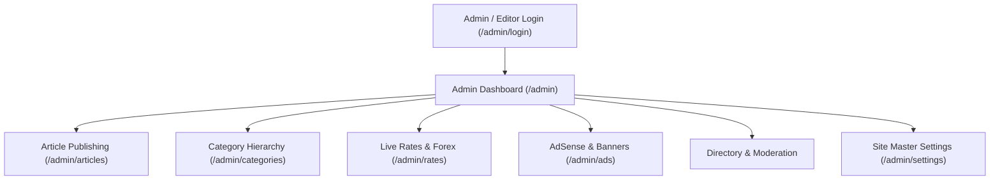
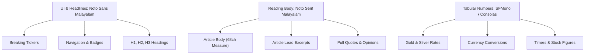
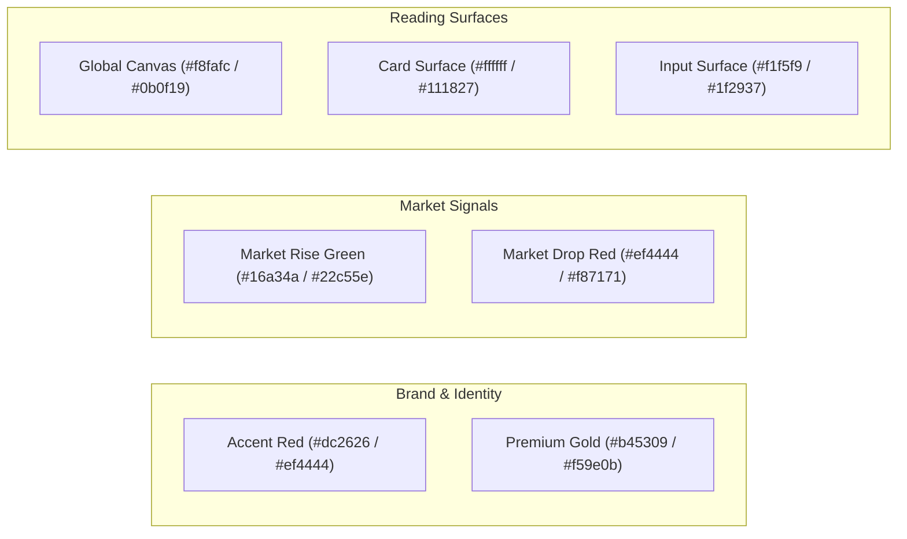

# Malayalam Business & Financial News Platform
## Comprehensive Specification: Features, Design System, Malayalam Typography & Color Tokens

---

## 1. Complete Feature Specifications

### 1.1 Public News Experience & Layout Modules

#### 1. Home Page & Category Tabbed Sections
* **Top Story Hero**: Lead news presentation featuring primary headline, lead paragraph excerpt, category badge, publication timestamp, estimated read-time, author avatar/byline, and high-resolution responsive picture (`` with srcset/aspect ratio preservation).
* **Category Tabs (`HomeTabbedSections.tsx`)**: Client-side tabbed navigation switching between core topics: **ബിസിനസ് (Business)**, **വിപണി (Markets)**, **സ്റ്റാർട്ടപ്പ് (Startups)**, **പഴ്സണൽ ഫിനാൻസ് (Personal Finance)**, **ടെക്നോളജി (Tech)**, and **പ്രവാസി (NRI/Gulf)**.
* **Breaking News Ticker (`NewsTicker.tsx`)**: High-visibility ticker positioned directly beneath the main navigation bar. Features an alert label (`ബ്രേക്കിംഗ്`), marquee/slide animation, and direct deep-links to urgent updates.
* **Sticky Utility Top Bar**: Features current Gregorian date in Malayalam format (`2026 ഒക്ടോബർ 29, വ്യാഴാഴ്ച`), live 22K gold rate indicator, and 3-way edition switch.
* **Regional Edition Switcher**:
  - `🌴 കേരളം (Kerala Edition)`: Local state economic and policy news.
  - `🌍 ഗൾഫ് / NRI (Gulf Edition)`: GCC remittances, Gulf market regulations, NRE deposit rates, diaspora business.
  - `🌐 ഗ്ലോബൽ (Global Edition)`: International macroeconomics, Wall Street, crude oil, global tech.
* **Kerala District News Selector (`KeralaDistrictSelector.tsx`)**: Filter stories across all 14 districts grouped by geographical zone (South, Central, North).

#### 2. Article Reader Experience (`/article/[slug]`)
* **Editorial Typography**: Long-form Malayalam text rendered in `Noto Serif Malayalam` with `line-height: 1.85` and maximum column width of `68ch` to avoid reader fatigue.
* **Audio News Simulation (`ArticleReaderView.tsx`)**: On-page audio reader widget with Play/Pause controls, simulated audio waveform progress, playback speed selector (1x, 1.25x, 1.5x), and duration counter.
* **Floating & Inline Social Share Bar (`ArticleShareBar.tsx`)**:
  - **WhatsApp**: Direct message share with encoded headline and canonical URL (critical channel in Kerala & GCC).
  - **Telegram**: Channel/chat sharing button.
  - **X (formerly Twitter)**: Formatted tweet intent.
  - **Facebook & LinkedIn**: Social feed sharing.
  - **Copy Link**: One-tap clipboard copy with visual "ലിങ്ക് കോപ്പി ചെയ്തു!" tooltip confirmation.
* **Mood & Reader Reactions (`ArticleReactions.tsx`)**:
  - Reactions: 👍 ഉപകാരപ്രദം (Helpful), ❤️ ഇഷ്ടപ്പെട്ടു (Love), 💡 വിജ്ഞാനപ്രദം (Insightful), 😲 അത്ഭുതം (Surprised), 🤔 വിയോജിക്കുന്നു (Disagree).
  - Real-time client count updates and local selection persistence.
* **Discussion & Commenting System (`ArticleComments.tsx`)**:
  - Nested comment threading with parent-child relationship.
  - User submission form (Name + Comment body) with pending moderation state.
  - Relative time display (e.g. `10 മിനിറ്റ് മുൻപ്`, `2 മണിക്കൂർ മുൻപ്`).
* **Related & Recommended Stories Grid**: Contextual algorithmic recommendations based on article category and shared tag taxonomy.
* **SEO & Metadata**: Dynamic OpenGraph tags, Twitter cards, canonical link tags, schema.org `NewsArticle` JSON-LD structured data for Google Search & Google News indexing.

---

### 1.2 Live Financial Tools & Calculators

#### 1. Kerala Gold Rate & Jewellery Purchase Calculator (`/tools/gold-rate`)
* **Daily Live Rates**:
  - 22K Gold (1 Gram)
  - 22K Gold (1 Pavan / 8 Grams)
  - 24K Pure Gold (1 Gram)
  - Silver (1 Gram & 1 Kilogram)
  - Daily Price Change indicator: ▲ (Increase in red/green) / ▼ (Decrease).
* **Jewellery Purchase Cost Calculator**:
  - Weight selection in **ഗ്രാം (Grams)** or **പവൻ (Pavans - 8g)**.
  - Dynamic quantity multiplier.
  - Adjustable **പണിക്കൂലി (Making Charges %)** slider (default 8%).
  - Automatic calculation of **3% GST** as per Indian taxation standards.
  - Instant breakdown: Base Gold Price + Making Charges + GST = Final Total Payable.

#### 2. Gulf & Global Currency Exchange Tracker (`/tools/currency`)
* **Live Exchange Rates against INR (₹)**:
  - 🇦🇪 AED (UAE Dirham)
  - 🇸🇦 SAR (Saudi Riyal)
  - 🇶🇦 QAR (Qatari Riyal)
  - 🇰🇼 KWD (Kuwaiti Dinar)
  - 🇴🇲 OMR (Omani Rial)
  - 🇧🇭 BHD (Bahraini Dinar)
  - 🇺🇸 USD (US Dollar)
  - 🇬🇧 GBP (British Pound)
  - 🇨🇦 CAD (Canadian Dollar)
* **Real-time Bidirectional Converter**: Input foreign currency amount and instantly see calculated INR with Indian numbering comma formatting.
* **Dynamic Admin Sync**: Live rates fetch directly from `/api/v1/rates`, allowing the admin to update any forex rate in real time without code deployment.

#### 3. Investment & Finance Calculators (`/tools/calculators`)
* **SIP Calculator**: Monthly investment, expected return rate (%), time horizon (years), total wealth accumulated, and profit gain.
* **Fixed Deposit (FD) & RD Calculator**: Principal, interest tenure, maturity payout.
* **Loan EMI Calculator**: Home loan, car loan, business loan monthly installment breakdown with interest/principal ratio.

---

### 1.3 Hyperlocal Coverage: 14 Kerala Districts (`/districts`)

* **Coverage Architecture**:
  - **South Zone (തെക്കൻ കേരളം)**: തിരുവനന്തപുരം (Thiruvananthapuram), കൊല്ലം (Kollam), പത്തനംതിട്ട (Pathanamthitta), ആലപ്പുഴ (Alappuzha).
  - **Central Zone (മധ്യ കേരളം)**: കോട്ടയം (Kottayam), ഇടുക്കി (Idukki), എറണാകുളം (Ernakulam/Kochi), തൃശ്ശൂർ (Thrissur), പാലക്കാട് (Palakkad).
  - **North Zone (വടക്കൻ കേരളം)**: മലപ്പുറം (Malappuram), കോഴിക്കോട് (Kozhikode), വയനാട് (Wayanad), കണ്ണൂർ (Kannur), കാസർഗോഡ് (Kasaragod).
* **District Edition Features**:
  - Individual district homepages (`/districts/[slug]`) displaying district headquarters, zonal tag, and localized industrial/business news.
  - Interactive district switcher pill bar.

---

### 1.4 Monetization & Commercial Hubs

#### 1. Kerala Business Directory (`/directory`)
* **Verified Listings**: Local Kerala enterprises, MSMEs, startups, and Gulf ventures.
* **Tier Categorization**: Free, Verified, Gold, Platinum badges.
* **Direct Connect Actions**: One-click WhatsApp chat launch, phone call, email, and website redirect.
* **Search & Filters**: Filter by business category (Finance, Retail, Technology, Export/Import, Healthcare, Tourism) and Kerala district.

#### 2. Employment & Recruitment Board (`/jobs`)
* **Job Categories**: IT/Tech, Finance & Accounting, Sales & Marketing, Healthcare, Operations, Gulf Opportunities.
* **Filters**: Work mode (Remote, On-site, Hybrid), Region (Kerala, Gulf, Global), Experience level, and Salary ranges.
* **Direct Application**: External redirect to corporate portal or mailto application trigger.

#### 3. Business Events, Awards & Conclaves (`/events`)
* **Event Profiles**: Event dates, venue/virtual platform, ticket prices (Free / INR), agenda overview, and featured sponsors.
* **Categories**: Investor conclaves, startup pitch days, trade expos, networking dinners, webinars.

#### 4. Classifieds Marketplace (`/classifieds`)
* **Listing Sectors**: Commercial Real Estate (Office spaces, retail shops), Business Assets & Machinery, Business for Sale/Partnership, Professional Services.
* **Direct Seller Verification**: Direct telephone and WhatsApp contact with district-level sorting.

#### 5. Premium Research Reports & E-Magazine (`/reports`)
* Comprehensive PDF sector analysis (Kerala Banking, EV Market, Rubber & Spice Plantation economics, NRI remittance trends).
* Download gating with subscription status validation.

---

### 1.5 Personalization & Paywall Subscription

#### 1. User Authentication & Session (`AuthProvider.tsx`)
* Passwordless email magic-link sign in with Supabase authentication.
* Session synchronization across multiple browser tabs.
* Persistent user profile with preferred language and notification flags.

#### 2. "My Saves" Offline/Cloud Bookmarks (`/saved`)
* Readers can save any article with one tap on the bookmark icon.
* Saved items are stored locally in `localStorage` for offline reading and synced to the user profile when logged in.
* Real-time saved count badge rendered in the header navigation.

#### 3. "My Feed" Algorithmic Personalization (`/my-feed` & `/interests`)
* Readers select preferred industries (e.g., Stock Market, Real Estate, Startups, Agriculture, Gold & Jewellery).
* The feed dynamically aggregates stories matching selected topics, filtering out non-relevant content.

#### 4. The Profit Premium Paywall (`/membership`)
* **Membership Tiers**:
  - **Monthly Plan**: ₹99/month (Exclusive analysis, ad-free experience, full e-magazines, stock alerts).
  - **Annual Pass**: ₹999/year (Save 17%, complete research archive, event discounts).
* **Content Metering**: Non-subscribers read the first 3 paragraphs of premium articles followed by an elegant gradient fade-out and subscription call-to-action box.

---

### 1.6 Editorial CMS & Administration (`/admin`)

* **Role-Based Access Control**:
  - `super_admin`: Full database access, staff management, settings.
  - `editor`: Publish, edit, schedule articles, moderate comments.
  - `author`: Draft articles, submit for review.
  - `ad_manager`: Configure AdSense, banner campaigns, track click/impression metrics.
* **Article Publishing Suite (`/admin/articles/new` & `/[id]`)**:
  - Malayalam Title, URL Slug (auto-generated), Excerpt, and HTML Body editor.
  - Category selector, Author attribution, Publication status (`draft`, `in_review`, `scheduled`, `published`).
  - **Paywall Switch**: `is_premium` checkbox with customizable preview paragraph count.
  - Hero image URL, image caption, and photo credits.
  - Custom SEO meta title and meta description overrides.
* **Main & Sub-Category Tree Management (`/admin/categories`)**:
  - **`✨ + പുതിയ പ്രധാന വിഭാഗം (Add Main Category)`**: Creates top-level category (`parent_id = null`).
  - **`↳ + പുതിയ ഉപവിഭാഗം (Add Sub-Category)`**: Creates child category nested under selected parent.
  - **Row Quick-Add (`↳ + ഉപവിഭാഗം`)**: Direct button on each parent category card to instantly open sub-category creation with that parent pre-selected.
  - Hierarchy tree search, branch collapse/expand (`+`/`−`), and sort order renumbering.
* **Live Gold & Forex Rates Manager (`/admin/rates`)**:
  - Live edit for 22K gram, 22K pavan, 24K gram, and Silver with daily change (+/- ₹).
  - Quick auto-calculation button: 1 Pavan = 8 x Gram rate.
  - Global currency table with in-place rate editing, delete, and **`+ പുതിയ കറൻസി ചേർക്കുക`** modal (Currency code, English/Malayalam names, flag emoji selector, and exchange rate to INR).
* **Ad Management & Google AdSense (`/admin/ads`)**:
  - Master AdSense toggle: Publisher ID (`ca-pub-XXXXXXXX`) and Auto Ads enable/disable.
  - **5 Configurable Ad Units**:
    1. `header_banner` (728x90 Leaderboard)
    2. `sidebar_banner` (300x250 Medium Rectangle)
    3. `article_middle` (Responsive In-Article Banner)
    4. `footer_banner` (728x90 Bottom Leaderboard)
    5. `sticky_mobile` (320x50 Mobile Anchor)
  - Toggle between **Direct Advertiser Banner** (image URL + target link + campaign name) and **Google AdSense Slot**.
  - Built-in analytics displaying total impressions and clicks per placement.

---

## 2. Design System & Component Styling

### 2.1 Design Philosophy
1. **Malayalam-First Readability**: Designed specifically to prevent glyph clipping of complex Malayalam conjuncts and diacritics.
2. **Editorial Credibility**: Clean newspaper-style aesthetic with crisp serif body text, modern sans-serif navigation, and clear visual hierarchy.
3. **High Viewport Contrast**: Light theme offers a warm white canvas (`#f8fafc`) with deep slate text (`#0f172a`); Dark theme provides an anti-glare midnight slate (`#0b0f19`) with soft white reading surfaces (`#111827`).
4. **Token-Only Styling**: No raw hex codes inside components. All styling references CSS design tokens mapped via Tailwind (`bg-surface`, `text-text`, `text-accent`, `border-border`).

---

### 2.2 Layout Geometry & Responsive Breakpoints

| Breakpoint | Pixel Width | Device Profile | Layout Adjustment |
| :--- | :--- | :--- | :--- |
| `sm` | `480px` | Large phones, portrait phablets | Single column feeds, compact horizontal scroll chips |
| `md` | `768px` | Tablets, landscape phones | 2-column article grids, expanded navigation drawers |
| `lg` | `1024px` | Laptops, small desktops | 3-column newspaper grid (Main News + Category Column + Live Sidebar) |
| `xl` | `1280px` | Large desktop displays | Maximum bounded width (`--content-max: 1280px`), fixed right-rail tools |

### 2.3 Surface Elevation & Shadow Tokens

| Token | Light Value | Dark Value | Component Application |
| :--- | :--- | :--- | :--- |
| `--shadow-card` | `0 1px 3px 0 rgb(0 0 0 / 0.08)` | `0 1px 3px 0 rgb(0 0 0 / 0.40)` | Standard article cards, tool boxes, category panels |
| `--shadow-pop` | `0 10px 15px -3px rgb(0 0 0 / 0.10)` | `0 10px 15px -3px rgb(0 0 0 / 0.50)` | Hovered cards, dropdown menus, modals, dialogs |

### 2.4 Border Radius Hierarchy

| Token | Value | Tailwind Class | Application |
| :--- | :--- | :--- | :--- |
| `--radius-sm` | `0.25rem` (4px) | `rounded-sm` / `rounded` | Input fields, category tags, author date badges |
| `--radius-md` | `0.50rem` (8px) | `rounded-md` | Standard buttons, card containers, dialog boxes |
| `--radius-lg` | `0.75rem` (12px) | `rounded-lg` / `rounded-xl` | Prominent hero cards, calculator containers, modals |
| `--radius-pill`| `9999px` | `rounded-pill` / `rounded-full`| Edition switcher pills, status badges, social buttons |

---

## 3. Malayalam Typography Mechanics & Scale

### 3.1 Malayalam Typography Challenges & Solutions

1. **Diacritic Collision Mitigation**:
   - Malayalam vowel signs (മാത്രകൾ) like **‘ു’**, **‘ൂ’**, **‘ൃ’**, **‘്ര’** project below the baseline, while signs like **‘ി’**, **‘ീ’**, **‘ൈ’** project above the cap-height.
   - Standard English line-height (`1.4` - `1.5`) clips these glyphs or causes lines to merge.
   - **Solution**: The platform enforces `--text-article-line: 1.85rem` (approx 1.85 line-height ratio) on body text, guaranteeing zero clipping.
2. **Agglutinative Word Length (അക്ഷരക്കൂട്ടങ്ങൾ)**:
   - Malayalam words are compound words and significantly longer than English words (e.g., `ധനകാര്യസ്ഥാപനങ്ങളിൽ`).
   - Narrow column containers cause awkward word breaks or jagged right margins.
   - **Solution**: The reading measure is bounded to `--article-measure: 68ch` (around 680px) with `word-break: break-word` and `hyphens: auto`.
3. **Tabular Numeric Alignment**:
   - Stock quotes and currency calculations require constant column alignment.
   - **Solution**: Font family `--font-mono` with `font-variant-numeric: tabular-nums` ensures numbers do not jump or jitter during updates.

---

### 3.2 Complete Typographic Scale

| Token | CSS Variable | Font Size | Line Height | Font Weight | Family | Intended Context |
| :--- | :--- | :--- | :--- | :--- | :--- | :--- |
| **Micro (xs)** | `--text-xs` | `0.75rem` (12px) | `1.00rem` (16px) | 400 / 600 | UI (Sans) | Timestamps, author names, tags, badges, captions |
| **Small (sm)** | `--text-sm` | `0.875rem` (14px) | `1.25rem` (20px) | 500 / 600 | UI (Sans) | Navigation links, breadcrumbs, input labels, tooltips |
| **Base (base)**| `--text-base` | `1.00rem` (16px) | `1.50rem` (24px) | 400 / 500 | UI (Sans) | Standard UI body text, buttons, form selects |
| **Article (article)**| `--text-article` | `1.125rem` (18px) | `1.85rem` (29.6px)| 400 | Reading (Serif) | **Article body text paragraph blocks** |
| **Large (lg)** | `--text-lg` | `1.125rem` (18px) | `1.75rem` (28px) | 600 / 700 | Reading (Serif) | Card headlines, section sub-headers |
| **Heading 1 (xl)**| `--text-xl` | `1.25rem` (20px) | `1.75rem` (28px) | 700 | Reading (Serif) | Secondary story headlines, modal titles |
| **Heading 2 (2xl)**| `--text-2xl`| `1.50rem` (24px) | `2.00rem` (32px) | 800 | Reading (Serif) | Section banner titles, tool hero titles |
| **Display (display)**| `--text-display`| `2.25rem` (36px)| `2.75rem` (44px)| 800 / 900 | Reading (Serif) | **Lead breaking hero headline, main article H1** |

---

## 4. Semantic Color Palette & Contrast Tokens

All colors are exposed as CSS custom properties with dedicated mappings for Light and Dark modes.

### 4.1 Master Color Token Matrix

| Token Name | Tailwind Class | Light Mode (Hex) | Dark Mode (Hex) | Contrast Ratio | Semantic Role & Guidance |
| :--- | :--- | :--- | :--- | :--- | :--- |
| `--color-bg` | `bg-bg` | `#f8fafc` | `#0b0f19` | N/A | Global viewport canvas backdrop. |
| `--color-surface` | `bg-surface` | `#ffffff` | `#111827` | > 14:1 vs text | Primary card containers, navbar, article reading pane. |
| `--color-surface-raised`| `bg-surface-raised`| `#f1f5f9` | `#1f2937` | > 10:1 vs text | Sub-panels, inputs, table alternating rows, widgets. |
| `--color-border` | `border-border` | `#e2e8f0` | `#374151` | Subtle rule | Card outlines, dividers, table horizontal rules. |
| `--color-border-input` | `border-border-input`| `#cbd5e1` | `#4b5563` | Visible box | Form input borders, select dropdown outlines. |
| `--color-text` | `text-text` | `#0f172a` | `#f9fafb` | > 15:1 (AAA) | High-contrast Malayalam editorial headlines & body prose. |
| `--color-text-muted` | `text-text-muted` | `#64748b` | `#9ca3af` | > 4.5:1 (AA) | Timestamps, author bylines, reading time, captions. |
| `--color-accent` | `bg-accent` / `text-accent`| `#dc2626` | `#ef4444` | > 4.8:1 | Primary brand red, breaking news pill, primary buttons. |
| `--color-on-accent` | `text-on-accent` | `#ffffff` | `#ffffff` | > 5.5:1 | Crisp white text rendered over accent buttons & pills. |
| `--color-success` | `text-success` | `#16a34a` | `#22c55e` | > 4.5:1 | Positive market change (▲), verified business checks. |
| `--color-danger` | `text-danger` | `#ef4444` | `#f87171` | > 4.5:1 | Negative market change (▼), delete actions, urgent alerts. |
| `--color-warning` | `text-warning` | `#d97706` | `#f59e0b` | > 4.5:1 | Caution alerts, system maintenance messages. |
| `--color-warning-bg` | `bg-warning-bg` | `#fef3c7` | `#451a03` | N/A | Background for warning callout boxes. |
| `--color-premium` | `text-premium` | `#b45309` | `#f59e0b` | > 4.5:1 | 👑 The Profit Premium badges, gold membership icons. |
| `--color-premium-bg` | `bg-premium-bg` | `#fffbeb` | `#291e0a` | N/A | Paywall teaser card background. |
| `--color-inverse-bg` | `bg-inverse-bg` | `#0f172a` | `#f9fafb` | Contrast | Tooltips, inverted badges, floating toasts. |
| `--color-inverse-text` | `text-inverse-text` | `#f8fafc` | `#111827` | High | Text placed on inverted tooltips. |

---

## 5. Technical Safeguards & Architecture

1. **Hydration Safeguard (`components/HydrationFix.tsx`)**:
   - Web browsers with auto-translation extensions (e.g. Google Chrome translate from Malayalam to English) or ad-blockers inject DOM nodes that can crash React during hydration (`Failed to execute 'removeChild' on 'Node'`).
   - The application intercepts `Node.prototype.removeChild` and `insertBefore` with a silent DOM rescue fallback.
   - `html` tag has `translate="no"` and `<meta name="google" content="notranslate" />` to protect core DOM reconciliation.
2. **Server-to-Disk Data Persistence (`lib/data/store.ts`)**:
   - Data mutations (publishing an article, adding a category, editing daily bullion or forex rates, updating AdSense slots) are stored in an in-memory singleton and automatically persisted to `.data-cache.json` on disk.
3. **Guaranteed Controlled Component State**:
   - Every input field across all admin and public pages implements default fallback values (`value={val || ''}`, `checked={Boolean(val)}`), eliminating React controlled-to-uncontrolled lifecycle warnings.
