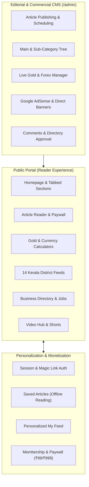
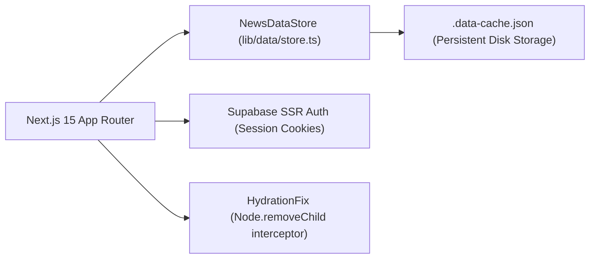

# Malayalam Business & Financial News Platform
## Comprehensive Feature, Design System, Typography & Color Specification

---

## 1. Executive Overview

This document provides an exhaustive reference of all architectural capabilities, functional modules, design tokens, typography scales, layout components, and light/dark color palettes implemented in the platform.



---

## 2. Platform Feature Inventory

### 2.1 Public News & Editorial Portal

| Feature | Route / Component | Description |
| :--- | :--- | :--- |
| **Hero & Top Stories** | `/` (`HomeTabbedSections.tsx`) | Lead breaking story with high-impact headline, category badge, date, read time, and curated secondary news grid. |
| **Category Tabs** | `/` (`HomeTabbedSections.tsx`) | Dynamic tabbed switcher on the homepage to explore stories across business, markets, startups, and tech. |
| **Breaking News Ticker** | Global Header (`NewsTicker.tsx`) | Animated real-time ticker displaying high-priority alerts with direct links. |
| **Article Detail Page** | `/article/[slug]` | Complete reading layout with Malayalam typography, hero imagery, author byline, date, and reading time. |
| **Text-to-Speech / Audio Reader** | `ArticleReaderView.tsx` | In-article audio player simulation for hands-free Malayalam news listening. |
| **Social Sharing Bar** | `ArticleShareBar.tsx` | Floating and inline WhatsApp, Telegram, X (Twitter), Facebook, LinkedIn, and copy-link share buttons. |
| **Mood Reactions** | `ArticleReactions.tsx` | Interactive reader reactions: Like (👍), Love (❤️), Insightful (💡), Surprised (😲), Disagree (🤔). |
| **Interactive Comments** | `ArticleComments.tsx` | Real-time reader discussion threads with parent-child replies and admin moderation status. |
| **Topics & Category Listing** | `/topic/[slug]` | Dedicated archives for main categories and subcategories with hierarchical breadcrumb navigation. |
| **Author Profiles** | `/author/[slug]` | Author bio, avatar, role, and comprehensive chronological archive of articles authored. |
| **Tag Archives** | `/tag/[tag]` | Tag-driven topic aggregation for trending themes (e.g., `#startups`, `#budget2026`). |
| **Site-Wide Search** | `/search` | Real-time Malayalam and English search querying titles, excerpts, tags, and category taxonomies. |
| **Sections Sitemap Index** | `/sections` | Visual directory displaying all 37 categories and subcategories with story counts. |
| **Regional Editions Switcher** | `Navbar.tsx` | 3-way edition toggle: **🌴 കേരളം (Kerala)**, **🌍 ഗൾഫ് / NRI (Gulf)**, and **🌐 ഗ്ലോബൽ (Global)**. |

---

### 2.2 Financial Tools & Live Market Rates

| Feature | Route / Component | Description |
| :--- | :--- | :--- |
| **Live Bullion Rates Ticker** | `Navbar.tsx` & `LiveRatesWidget.tsx` | Real-time Kerala Gold 22K (1g & 1 pavan), 24K, and Silver prices with daily change indicators (▲/▼ ₹). |
| **Gold Rate & Jewellery Calculator** | `/tools/gold-rate` | Real-time bullion tracker with interactive purchase calculator: customizable gram/pavan weight, making charges (%), and 3% GST computation. |
| **Gulf & Global Forex Converter** | `/tools/currency` | Real-time foreign exchange converter (AED, SAR, QAR, KWD, OMR, BHD, USD, GBP, CAD) into Indian Rupees (INR). |
| **Financial Calculators Hub** | `/tools/calculators` | Specialized investment calculators: SIP wealth builder, Fixed Deposit (FD), Recurring Deposit (RD), Loan EMI, and GST. |

---

### 2.3 Hyperlocal Kerala District News

| Feature | Route / Component | Description |
| :--- | :--- | :--- |
| **District Hub** | `/districts` | Kerala statewide map selector covering all 14 revenue districts. |
| **District Edition Pages** | `/districts/[slug]` | Hyperlocal news archive for Thiruvananthapuram, Kollam, Pathanamthitta, Alappuzha, Kottayam, Idukki, Ernakulam, Thrissur, Palakkad, Malappuram, Kozhikode, Wayanad, Kannur, and Kasaragod. |
| **Zonal Classification** | `KeralaDistrictSelector.tsx` | Filter stories across **South Kerala**, **Central Kerala**, and **North Kerala**. |

---

### 2.4 Commercial Hubs & Revenue Generation

| Feature | Route / Component | Description |
| :--- | :--- | :--- |
| **Kerala Business Directory** | `/directory` | Searchable directory of verified Kerala & GCC businesses. Includes direct WhatsApp connect, address, phone, website, and tier levels (Free, Gold, Platinum). |
| **Job Board & Recruitment** | `/jobs` | Job listings for Kerala, Gulf, and Remote positions. Filter by employment type, salary, experience, and direct apply link. |
| **Conferences & Events** | `/events` | Business summits, networking conclaves, awards ceremonies, ticket pricing, and booking links. |
| **Classified Advertisements** | `/classifieds` | Classified listings for Commercial Property, Machinery, Vehicles, and Business-for-Sale. |
| **Brand Connect (Sponsored)** | `/brand-connect` | Clearly marked native sponsored storytelling and corporate profiles. |
| **Research Reports & E-Magazines** | `/reports` | Downloadable in-depth industry research whitepapers and monthly PDF publications. |

---

### 2.5 Personalization & Paywall Subscriptions

| Feature | Route / Component | Description |
| :--- | :--- | :--- |
| **User Authentication** | `/auth/login` (`AuthProvider.tsx`) | Email magic-link and session-cookie authentication with persistent state. |
| **Reading List ("My Saves")** | `/saved` | Local and cloud bookmarking allowing users to save articles for later reading. |
| **Personalized Feed ("My Feed")**| `/my-feed` | Algorithmically curated feed matching the user's explicit topics of interest. |
| **Topic Preference Manager** | `/interests` | Interactive tag selection enabling readers to follow specific industry domains. |
| **Membership & Paywall** | `/membership` | Multi-tier membership (Monthly ₹99, Annual Pass ₹999). Features paywall gating with first 3 preview paragraphs for non-subscribers. |
| **Account Management** | `/account` | Active subscription details, renew options, preferences, and sign-out controls. |

---

### 2.6 Editorial & Commercial Admin Portal (`/admin`)

| Admin Module | Route | Functionality |
| :--- | :--- | :--- |
| **Dashboard Home** | `/admin` | Metrics overview: total published articles, draft count, active ad impressions, clicks, comments. |
| **Article CMS** | `/admin/articles` | List, search, filter, and delete published and draft articles. |
| **Article Editor** | `/admin/articles/new` & `/[id]` | Malayalam-compatible editorial interface: headline, slug, excerpt, body HTML, category, author, status, premium paywall toggle, preview paragraph limit, hero image URL, and SEO tags. |
| **Category Hierarchy** | `/admin/categories` | **Dedicated actions for Main Category (`parent_id: null`)** and **Sub-Category**. Inline row quick-add (`↳ + ഉപവിഭാഗം`), tree search, collapse/expand branches, and nav display controls. |
| **Rates & Currencies** | `/admin/rates` | Real-time update for Kerala Gold (22K 1g, 22K 8g pavan, 24K, Silver) with 8x auto-calculator. Forex currency editor with "+ പുതിയ കറൻസി ചേർക്കുക" modal, flag selector, search, and delete. |
| **Advertising Manager** | `/admin/ads` | Master Google AdSense controls (Publisher ID, Auto Ads). 5 display placements (`header_banner`, `sidebar_banner`, `article_middle`, `footer_banner`, `sticky_mobile`) with Direct vs AdSense toggle, banner image URLs, target click links, and analytics. |
| **Featured Placements** | `/admin/featured` | Slot assignment for Hero, Breaking News, Top Markets, and Brand Connect homepage rails. |
| **Comment Moderation** | `/admin/comments` | Approve, hide, or delete community comments across all articles. |
| **Business Directory CMS** | `/admin/directory` | Verify, activate, or remove business listings and assign tiers. |
| **Job Postings CMS** | `/admin/jobs` | Post and manage recruitment notices with expiry and active toggles. |
| **Events Manager** | `/admin/events` | Create and manage business summits, dates, pricing, and venues. |
| **Staff Roles & Access** | `/admin/roles` | Role-based permission assignments: Super Admin, Editor, Author, Ad Manager. |
| **Site Settings** | `/admin/settings` | Master controls: breaking news marquee text/link, edition defaults, social channels, and maintenance mode. |

---

## 3. Design System & Typography

### 3.1 Font Families

The platform implements a font stack calibrated for high Malayalam glyph legibility and contrast:

```css
/* UI, Navigation, Headlines & Data Displays */
--font-ui: var(--font-noto-sans-ml), -apple-system, BlinkMacSystemFont, "Segoe UI", Roboto, sans-serif;

/* Long-Form Editorial & Article Body */
--font-reading: var(--font-noto-serif-ml), Georgia, Cambria, "Times New Roman", serif;

/* Financial Tickers, Rates & Code */
--font-mono: ui-monospace, SFMono-Regular, Menlo, Monaco, Consolas, monospace;
```

### 3.2 Typographic Hierarchy & Scale

| Token | Size | Line Height | Weight | Ideal Usage |
| :--- | :--- | :--- | :--- | :--- |
| `--text-xs` | `0.75rem` (12px) | `1.00rem` (16px) | 400 / 600 | Metadata, timestamps, tags, badges, captions |
| `--text-sm` | `0.875rem` (14px) | `1.25rem` (20px) | 400 / 600 | Navigation links, tooltips, secondary descriptions |
| `--text-base` | `1.00rem` (16px) | `1.50rem` (24px) | 400 / 500 | Standard UI prose, form inputs, button labels |
| `--text-article` | `1.125rem` (18px) | `1.85rem` (29.6px) | 400 | **Article body text** (optimized Malayalam leading) |
| `--text-lg` | `1.125rem` (18px) | `1.75rem` (28px) | 600 | Subheadings, card titles, section headers |
| `--text-xl` | `1.25rem` (20px) | `1.75rem` (28px) | 700 | Primary card headlines, modal titles |
| `--text-2xl` | `1.50rem` (24px) | `2.00rem` (32px) | 700 / 800 | Section titles, article sub-headers, tool titles |
| `--text-display` | `2.25rem` (36px) | `2.75rem` (44px) | 800 / 900 | Hero headlines, main article headline, landing titles |

### 3.3 Layout Constraints & Geometry

| Token | Value | Purpose |
| :--- | :--- | :--- |
| `--content-max` | `1280px` | Maximum container width for desktop layouts |
| `--article-measure` | `68ch` | Ideal line length for Malayalam readability without eye fatigue |
| `--radius-sm` | `0.25rem` (4px) | Inputs, small tags, badges |
| `--radius-md` | `0.50rem` (8px) | Buttons, cards, dropdowns |
| `--radius-lg` | `0.75rem` (12px) | Modals, prominent hero cards, containers |
| `--radius-pill` | `9999px` | Edition toggles, status pills, reaction pills |
| `--motion-fast` | `150ms` | Button hover states, icon transitions |
| `--motion-base` | `250ms` | Modal opens, accordion collapse, drawer slides |
| `--motion-ease` | `cubic-bezier(0.4, 0, 0.2, 1)` | Standard natural ease transition |

---

## 4. Color Palette & Theming (Light & Dark Mode)

The color system is driven strictly through semantic CSS variables and Tailwind extensions (`bg-surface`, `text-text-muted`, `border-border`), preventing hardcoded hex inconsistencies across themes.

### 4.1 Token Mapping Table

| Semantic Token | Tailwind Class | Light Mode Value | Dark Mode Value | Semantic Role |
| :--- | :--- | :--- | :--- | :--- |
| `--color-bg` | `bg-bg` | `#f8fafc` (Slate 50) | `#0b0f19` (Deep Slate) | Global canvas backdrop |
| `--color-surface` | `bg-surface` | `#ffffff` (Pure White) | `#111827` (Gray 900) | Primary cards, navbar, article reading pane |
| `--color-surface-raised`| `bg-surface-raised` | `#f1f5f9` (Slate 100) | `#1f2937` (Gray 800) | Inner card panels, inputs, secondary widgets |
| `--color-border` | `border-border` | `#e2e8f0` (Slate 200) | `#374151` (Gray 700) | Dividers, card boundaries, table rules |
| `--color-border-input` | `border-border-input` | `#cbd5e1` (Slate 300) | `#4b5563` (Gray 600) | Form controls, input borders |
| `--color-text` | `text-text` | `#0f172a` (Slate 900) | `#f9fafb` (Gray 50) | High-contrast body text & headlines |
| `--color-text-muted` | `text-text-muted` | `#64748b` (Slate 500) | `#9ca3af` (Gray 400) | Metadata, timestamps, captions, secondary info |
| `--color-accent` | `text-accent` / `bg-accent` | `#dc2626` (Red 600) | `#ef4444` (Red 500) | Primary brand red, breaking news, primary CTA |
| `--color-on-accent` | `text-on-accent` | `#ffffff` | `#ffffff` | Text on red buttons & badges |
| `--color-danger` | `text-danger` | `#ef4444` (Red 500) | `#f87171` (Red 400) | Negative market change (▼), delete actions |
| `--color-success` | `text-success` | `#16a34a` (Green 600) | `#22c55e` (Green 500) | Positive market change (▲), verified badges |
| `--color-warning` | `text-warning` | `#d97706` (Amber 600) | `#f59e0b` (Amber 500) | Important alerts, notices |
| `--color-warning-bg` | `bg-warning-bg` | `#fef3c7` (Amber 100) | `#451a03` (Dark Amber) | Warning highlight cards |
| `--color-premium` | `text-premium` | `#b45309` (Gold Amber) | `#f59e0b` (Bright Gold) | 👑 Premium paywall indicators, gold tier badges |
| `--color-premium-bg` | `bg-premium-bg` | `#fffbeb` (Cream Gold) | `#291e0a` (Deep Gold) | Premium article paywall teaser callout background |
| `--color-inverse-bg` | `bg-inverse-bg` | `#0f172a` | `#f9fafb` | Tooltip & inverse badge backgrounds |
| `--color-inverse-text` | `text-inverse-text` | `#f8fafc` | `#111827` | Text placed on inverse backgrounds |

### 4.2 Elevation & Drop Shadows

| Token | Light Mode Value | Dark Mode Value | Usage |
| :--- | :--- | :--- | :--- |
| `--shadow-card` | `0 1px 3px 0 rgb(0 0 0 / 0.08)` | `0 1px 3px 0 rgb(0 0 0 / 0.40)` | Standard news cards, widgets |
| `--shadow-pop` | `0 10px 15px -3px rgb(0 0 0 / 0.10)` | `0 10px 15px -3px rgb(0 0 0 / 0.50)` | Hovered cards, dropdowns, floating modals |

---

## 5. Technical Architecture & Safeguards



1. **Hydration & Extension Safeguard (`components/HydrationFix.tsx`)**:
   - Intercepts `Node.prototype.removeChild` and `insertBefore` exceptions caused by external browser extensions (Google Translate, Grammarly, Adblockers) altering server-rendered DOM nodes.
   - Root layout tagged with `translate="no"` and `<meta name="google" content="notranslate" />`.
2. **Local Cache Persistence**:
   - `NewsDataStore` synchronizes all CMS modifications (articles, categories, daily gold rates, global forex rates, ad slot settings) to `.data-cache.json` on the server disk.
3. **Controlled Component Guarantee**:
   - All admin forms and public tools enforce non-null fallback values (`value={slot.direct_banner_url || ''}`, `checked={Boolean(slot.is_active)}`) to ensure inputs remain 100% controlled across their lifecycle.
